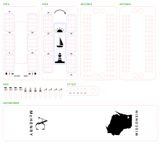

This is a cribbage board that I made with an xTool P2. I drew the cut file as an SVG. The board is two layers of 3mm plywood with a pleather flap that wraps around it, and magnets hidden behind the first wood layer to keep it shut. It has room for three players or teams and folds in half to the size of a smartphone.

The pegs have a Milwaukee theme: a beer stein, a lighthouse, and a cheese wedge. I painted each peg before lasering so the engraving shows the bare wood underneath.

The cover is pleather and has a monogram on one side and a map of Wisconsin on the other.

